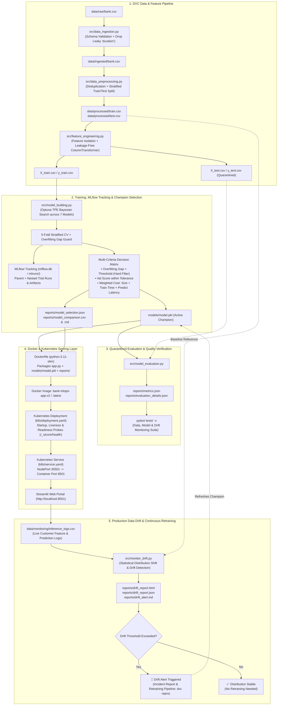

# 🏦 Bank Marketing Campaign Prediction — End-to-End MLOps System

An end-to-end, reproducible Machine Learning Operations (MLOps) system built for **Bank Marketing Campaign Term-Deposit Subscription Prediction**. Taking raw customer demographic, financial, and campaign contact records (`bank.csv`), this system implements the complete production ML lifecycle: **data ingestion and leakage prevention, deduplication and stratified splitting, leakage-free preprocessing pipelines, Optuna Bayesian hyperparameter search across 7 candidate algorithms, MLflow experiment tracking, automated multi-criteria champion selection, quarantined test-set evaluation, automated `pytest` validation, Docker containerization, Kubernetes deployment (`Deployment` + `NodePort` Service), and production inference logging with statistical data drift detection & alerting**.

---

## 🏛️ End-to-End System Architecture



---

## 🔄 What Was Built From Start to End

1. **Data Ingestion & Leakage Prevention (`src/data_ingestion.py`):**
   * Loads the raw bank marketing dataset (`data/raw/bank.csv`), validates expected columns and target labels (`deposit`: `"yes"` / `"no"`), and drops `duration` (call length, which is only known *after* a call finishes and would leak the outcome in real-world pre-call targeting).
2. **Data Preprocessing (`src/data_preprocessing.py`):**
   * Removes duplicate records, encodes the binary target (`1` for subscribed, `0` otherwise), and performs a reproducible stratified train/test split (`80/20`) so class balance is preserved across splits.
3. **Leakage-Free Feature Engineering (`src/feature_engineering.py` & `ColumnTransformer`):**
   * Separates predictors (`X_train`, `y_train`, `X_test`, `y_test`) while keeping `X_test` strictly quarantined until final evaluation.
   * Numeric imputation (`median`), scaling (`StandardScaler` / `MinMaxScaler`), categorical imputation (`most_frequent`), and `OneHotEncoder(handle_unknown="ignore")` are encapsulated inside the Scikit-Learn `Pipeline` so statistics are fit only on training folds.
4. **7-Model Bayesian Hyperparameter Optimization (`src/model_building.py`):**
   * Runs Optuna (`TPESampler`) with 5-fold stratified cross-validation across **7 distinct model families**:
     1. **K-Nearest Neighbors (`KNN`)**
     2. **Decision Tree (`DecisionTree`)**
     3. **Logistic Regression (`LogisticRegression`)**
     4. **Gaussian Naive Bayes (`GaussianNB`)**
     5. **Random Forest (`RandomForest`)**
     6. **Gradient Boosting (`GradientBoosting`)**
     7. **XGBoost (`XGBoost`)**
   * Handles class imbalance natively via `class_weight="balanced"` and `scale_pos_weight` ($1.0$, $\sqrt{\text{neg}/\text{pos}}$, and $\text{neg}/\text{pos}$).
5. **Experiment Tracking with MLflow:**
   * Logs every parent model run and nested Optuna trial (`scaler_type`, hyperparameters, CV validation score, CV training score, generalization gap, model size MB, training time seconds, prediction latency ms, and serialized `.pkl` artifacts) to `mlflow.db` / `mlruns/`.
6. **Automated Multi-Criteria Champion Selection:**
   * Evaluates all 7 candidate models against generalization gap limits, score tolerance, and normalized operational cost (model size, fit time, and single-row prediction latency), automatically copying the winning pipeline to `models/model.pkl` and writing `reports/model_selection.json`, `reports/model_comparison.csv`, and `reports/model_comparison.md`.
7. **Independent Test Evaluation (`src/model_evaluation.py`) & Automated Tests (`tests/`):**
   * Evaluates the selected champion (`models/model.pkl`) once on the untouched test split (`X_test.csv`, `y_test.csv`), exports `reports/metrics.json` and `reports/evaluation_details.json`, and validates data integrity, model inference, and drift monitoring via `pytest`.
8. **Interactive Streamlit Application (`app.py`):**
   * Serves real-time single-customer subscription predictions, batch CSV scoring, candidate model comparison leaderboards, champion selection governance details, and **live production data drift diagnostics**.
9. **Docker Containerization (`Dockerfile` & `.dockerignore`):**
   * Packages only the lean runtime dependencies (`requirements.txt`), `app.py`, the champion `models/model.pkl`, and `reports/` into a `python:3.11-slim` image with a built-in `/_stcore/health` healthcheck, excluding raw data, training code, virtual environments, and non-champion `.pkl` files.
10. **Kubernetes Orchestration (`k8s/deployment.yaml` & `k8s/service.yaml`):**
    * Deploys the containerized Streamlit application on a local Kubernetes cluster (Docker Desktop Kubernetes) with rolling updates, CPU/memory resource limits, `startupProbe`, `livenessProbe`, and `readinessProbe` checks, exposed via a `NodePort` service (`8501` $\rightarrow$ `30501`).
11. **Production Data Drift Detection & Alerting (`src/monitor_drift.py`):**
    * Captures live customer feature payloads and predicted subscription probabilities in `data/monitoring/inference_logs.csv`, compares live production distributions against the training baseline (`data/processed/train.csv`) using statistical drift tests (Kolmogorov-Smirnov test for numeric features and distribution shift checks for categorical features), and generates `reports/drift_report.html`, `reports/drift_report.json`, and `reports/drift_alert.md` to trigger retraining when campaign customer profiles shift.

---

## 📁 Repository Directory Structure

```text
├── .dvc/                                   # DVC internal configuration and local cache
├── k8s/                                    # Kubernetes deployment & service manifests
│   ├── deployment.yaml                     # RollingUpdate Deployment with health probes & resource limits
│   └── service.yaml                        # NodePort Service (port 8501 -> nodePort 30501)
├── data/
│   ├── raw/                                # Source raw dataset (bank.csv)
│   ├── ingested/                           # Validated raw data with leaky columns removed
│   ├── processed/                          # Train/test splits and separated X/y feature matrices
│   └── monitoring/                         # Append-only live inference logs (inference_logs.csv)
├── models/                                 # Trained candidate models & active champion artifact
│   ├── KNN.pkl
│   ├── DecisionTree.pkl
│   ├── LogisticRegression.pkl
│   ├── GaussianNB.pkl
│   ├── RandomForest.pkl
│   ├── GradientBoosting.pkl
│   ├── XGBoost.pkl
│   └── model.pkl                           # Active champion pipeline deployed in production
├── reports/                                # Generated audit, benchmark, evaluation & drift reports
│   ├── drift_alert.md                      # Auto-generated Markdown incident alert on drift breach
│   ├── drift_report.html                   # Interactive visual HTML data drift dashboard
│   ├── drift_report.json                   # Machine-readable feature-by-feature drift statistics
│   ├── evaluation_details.json             # Detailed classification report & confusion metrics
│   ├── metrics.json                        # Flat evaluation metrics tracked by DVC
│   ├── model_comparison.csv                # Benchmark table across all 7 candidate models
│   ├── model_comparison.md                 # Markdown comparison table
│   └── model_selection.json                # Champion selection criteria, weights & rationale
├── src/                                    # Modular MLOps pipeline source code
│   ├── data_ingestion.py                   # Data loading, schema checks, and leaky feature removal
│   ├── data_preprocessing.py               # Deduplication and stratified train/test splitting
│   ├── feature_engineering.py              # Feature/target separation and leakage-free prep
│   ├── model_building.py                   # Optuna HPT across 7 models, MLflow logging & selection
│   ├── model_evaluation.py                 # Quarantined test-set evaluation & report generation
│   └── monitor_drift.py                    # Production inference logging, drift tests & alerting
├── tests/                                  # Automated test suite (pytest)
│   ├── test_data.py                        # Data schema, leakage removal, and split validation
│   ├── test_model.py                       # Champion artifact loading, prediction & probability checks
│   └── test_monitoring.py                  # Inference logging, KS drift test & alert verification
├── .dockerignore                           # Excludes training data, venvs, and non-champion models
├── .dvcignore                              # DVC tracking exclusions
├── .gitignore                              # Git exclusions (models, caches, mlflow.db, venvs)
├── app.py                                  # Multi-tab Streamlit web portal (Inference, Lineage & Drift)
├── Dockerfile                              # Lean python:3.11-slim serving container definition
├── dvc.lock                                # Cryptographic state lockfile of DVC pipeline stages
├── dvc.yaml                                # Declarative DVC pipeline stage definitions
├── mlflow.db                               # Local SQLite backend for MLflow tracking
├── params.yaml                             # Centralized pipeline, metric, and selection parameters
├── requirements-dvc.txt                    # Full training, DVC, Optuna, XGBoost & MLflow dependencies
└── requirements.txt                        # Minimal runtime dependencies for Docker & Kubernetes
```

---

## ⚡ Core MLOps Pillars

### 1. Reproducible Data & Training Pipeline (DVC)
Every stage—from raw ingestion to final evaluation—is declared in `dvc.yaml` and locked in `dvc.lock`. Running:
```bash
dvc repro
```
automatically checks file and parameter hashes in `params.yaml` and executes only the stages affected by your changes.

### 2. Multi-Model Competition & Governance
In `src/model_building.py`, all **7 candidate models** compete on identical 5-fold stratified cross-validation splits using Optuna's `TPESampler`:
* **Generalization Guard:** Candidates whose train–validation score gap exceeds `max_score_gap_pct` are penalized during search and filtered out before selection.
* **Score-First Tolerance:** Eligible models within `score_tolerance_pct` of the top validation score qualify as finalists.
* **Operational Cost Tie-Breaker:** Finalists are ranked using normalized model size (`MB`), training time (`s`), and per-sample inference latency (`ms`):
  $$\text{Cost} = w_{\text{size}} \cdot \text{Size}_{\text{norm}} + w_{\text{train}} \cdot \text{TrainTime}_{\text{norm}} + w_{\text{pred}} \cdot \text{Latency}_{\text{norm}}$$

### 3. Experiment Tracking (MLflow)
Every model family logs a parent run plus nested runs for each Optuna trial, capturing hyperparameters, CV scores, generalization gaps, latency benchmarks, and serialized pipelines (`cloudpickle` / `.pkl`). Launch the MLflow UI locally anytime:
```bash
mlflow ui --backend-store-uri sqlite:///mlflow.db
```

### 4. Containerization (Docker)
`Dockerfile` builds a compact production image (`python:3.11-slim`) containing only `requirements.txt`, `app.py`, `models/model.pkl`, and `reports/`. `.dockerignore` strips out `data/`, `src/`, `mlruns/`, `mlflow.db`, virtual environments, and non-champion `.pkl` files to keep builds fast and lightweight.

### 5. Kubernetes Orchestration (`k8s/`)
Unlike standalone container runs, this project deploys the serving layer on **Kubernetes** (`k8s/deployment.yaml` and `k8s/service.yaml`):
* **Zero-Downtime Rolling Updates:** Configured with `RollingUpdate` (`maxSurge: 1`, `maxUnavailable: 0`).
* **Health Probes:** `startupProbe`, `livenessProbe`, and `readinessProbe` continuously poll Streamlit's `/_stcore/health` endpoint on port `8501` and automatically restart unhealthy pods.
* **Resource Governance:** Enforces CPU (`250m` request / `1000m` limit) and memory (`512Mi` request / `2Gi` limit) boundaries.
* **Service Exposure:** Exposes the pod via `bank-mlops-service` (`NodePort` `30501` $\rightarrow$ `8501`) as well as `kubectl port-forward`.

### 6. Production Data Drift Detection & Continuous Retraining (CT)
In real-world bank marketing campaigns, customer demographics, account balances, contact frequencies, and macroeconomic indicators shift over time—causing silent model degradation even when infrastructure health checks pass. This project actively guards against covariate and prediction drift:
* **Live Inference Logging:** Every prediction made through `app.py` (single-customer or batch scoring) appends input features, predicted class (`yes`/`no`), subscription probability, and timestamp to `data/monitoring/inference_logs.csv`.
* **Statistical Drift Testing (`src/monitor_drift.py`):** Compares incoming production traffic against the training baseline (`data/processed/train.csv`) across numeric features (two-sample Kolmogorov-Smirnov test) and categorical/prediction distributions to flag statistically significant shifts ($p < 0.05$).
* **Visual & Structured Drift Artifacts:** Generates `reports/drift_report.html` for visual distribution inspection, `reports/drift_report.json` for automated threshold checks, and `reports/drift_alert.md` summarizing drifted features and severity.
* **Closed-Loop Retraining Trigger:** When the share of drifted features breaches the configured alert threshold, an incident report (`reports/drift_alert.md`) is raised to trigger pipeline re-execution (`dvc repro`), re-optimizing all 7 models and promoting a refreshed champion to Kubernetes.

---

## 🚀 Quickstart Guide

### 1. Set Up Python Environment
```powershell
# Create and activate virtual environment (Windows PowerShell)
python -m venv myenv
myenv\Scripts\Activate.ps1

# Install full training & pipeline dependencies
pip install -r requirements-dvc.txt
```

### 2. Run the End-to-End DVC Pipeline
```powershell
dvc repro
dvc metrics show
```
This executes data ingestion, preprocessing, feature engineering, 7-model Optuna optimization + champion selection, and quarantined test-set evaluation.

### 3. Run the Automated Test Suite
```powershell
pytest tests/ -v
```
Validates dataset schema and leakage guards, champion model loading and prediction outputs, and data drift statistical detection and alert generation.

### 4. Run Production Data Drift Analysis
```powershell
# Evaluate live inference logs against the training baseline
python src/monitor_drift.py

# Simulate shifted customer campaign traffic to test drift alerting
python src/monitor_drift.py --simulate-drift
```
Open `reports/drift_report.html` in your browser to inspect feature-by-feature distribution comparisons, or check `reports/drift_alert.md` for incident diagnostics.

### 5. Run the Streamlit App Locally (Without Docker/K8s)
```powershell
streamlit run app.py
```
Open [http://localhost:8501](http://localhost:8501) in your browser to access live inference, model comparison benchmarks, and data drift monitoring.

---

## 🐳 Docker Build & Verification

Make sure `dvc repro` has generated `models/model.pkl` and `reports/` before building the image:
```powershell
# Build the production Docker image
docker build --no-cache -t bank-mlops-app:v2 .

# Verify the packaged model comparison report inside the image
docker run --rm --entrypoint cat bank-mlops-app:v2 reports/model_comparison.csv
```

---

## ☸️ Kubernetes Deployment (Docker Desktop)

Ensure **Kubernetes** is enabled and active in **Docker Desktop**, then deploy the manifests in `k8s/`:
```powershell
# 1. Apply the Deployment and NodePort Service
kubectl apply -f k8s\deployment.yaml -f k8s\service.yaml

# 2. Point deployment to your newly built image and wait for rollout
kubectl set image deployment/bank-mlops-app streamlit-app=bank-mlops-app:v2
kubectl rollout status deployment/bank-mlops-app

# 3. Verify pod health and packaged reports inside the running container
kubectl get pods,svc -l app=bank-mlops-app
$pod = kubectl get pods -l app=bank-mlops-app -o jsonpath="{.items[0].metadata.name}"
kubectl exec $pod -- cat reports/model_comparison.csv

# 4. Forward service port to localhost and open the UI
kubectl port-forward svc/bank-mlops-service 8501:8501
```
Once port-forwarding is active, open [**http://localhost:8501**](http://localhost:8501) (or access the `NodePort` at [**http://localhost:30501**](http://localhost:30501)) to interact with the live Kubernetes-hosted prediction and drift-monitoring portal.

---

## 📜 License
This project is open-source and available under the MIT License.